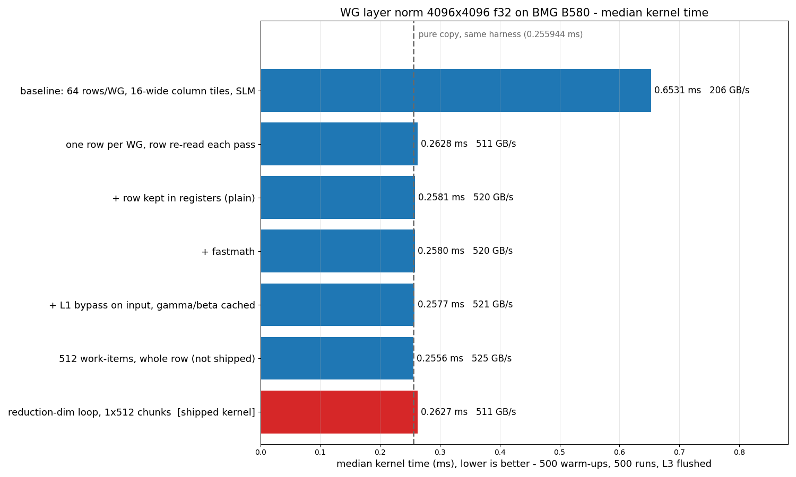

# Layer Norm Performance study on BMG B580

**Workload:** row-wise layer norm over a `4096x4096` f32 matrix
(`test/Integration/Dialect/XeGPU/WG/layer_norm_4096x4096.mlir`).

```
out[i, j] = (x[i, j] - mean_i) * rsqrt(var_i + eps) * gamma[j] + beta[j]
```

### Machine-specific information:
-----------------------------
**Machine:** `BMG B580`, `160` compute units, `18 MiB` L3 cache, `456 GB/s` DRAM spec peak.

### Workload-specific information:
-----------------------------
**Input:** random numbers in `[24.5, 25.5]`, plus a **per-row** offset in `[-512, 511]`.
gamma is random in `[0.5, 1.5]`, beta in `[-0.1, 0.1]`.

**Shape:** `4096 x 4096` f32 (64 MiB in, 64 MiB out, plus 16 KiB each of gamma and beta)

**Decomposition:** one row per work-group, walked in `1x512` chunks (8 iterations)

**Work-group size:** `256` work-items (16 subgroups). **Grid:** `4096` work-groups.

**Correctness:** max absolute error against an f64 CPU reference, bound `2e-3`. The
per-row offset makes the cheap variance `E[x^2] - E[x]^2` fail in f32, so the kernel
must use the stable form: the mean first, then `mean((x - mean)^2)`.

### Measurement:
-----------------------------
- `IMEX_ENABLE_PROFILING=1`, `IMEX_PROFILING_WARMUPS=500`, `IMEX_PROFILING_RUNS=500`,
  `IMEX_ENABLE_CACHE_FLUSHING=1`, default GRF.
- The cache flush fills a buffer four times the L3 size with zeros and waits for it before each
  timed run (the updated `build_tools/patches/0013`). Flushed times are lower than
  back-to-back times here: the data is much larger than the L3, so there is no warm cache
  to lose, and a back-to-back run starts with the previous run's output still dirty in
  the cache. Earlier versions of this report used an older flush, so their times are higher.
- Each time is the median of 11 interleaved repetitions. All rows come from one batch,
  so they can be compared directly.
- **Effective GB/s** is `134217728 Byte` (one read and one write of the matrix) divided
  by the time.

## Summary (optimization ladder)

Each row changes one thing from the row above. The last two rows are references in the
same harness.

The effective bandwidth is above the `456 GB/s` DRAM spec. The GPU compresses memory,
and this input compresses well, so fewer bytes reach DRAM than the matrix size.

| Configuration | Median (ms) | Effective GB/s | Speedup vs. baseline |
| --- | ---: | ---: | ---: |
| Baseline: 64 rows/WG, 16-wide column tiles, SLM accumulate | 0.653120 | 205.5 | 1.00x |
| One row per WG, row re-read on every pass | 0.262808 | 510.7 | 2.49x |
| + row kept in registers | 0.258128 | 520.0 | 2.53x |
| + `fastmath` (`native_rsqrt`, `native_divide`) | 0.258024 | 520.2 | 2.53x |
| + L1 bypass on the input, gamma/beta cached | 0.257712 | 520.8 | 2.53x |
| **Row 5 + reduction-dim loop, `1x512` chunks (shipped)** | **0.262704** | **510.9** | **2.49x** |
| *Whole row, 512 work-items (not shipped)* | 0.255632 | 525.0 | 2.55x |
| *Reference: pure copy of the same data* | 0.255944 | 524.4 | 2.55x |

## Median time comparison



## Optimization details

- **Baseline** — 64 rows per work-group in 16-wide column tiles (`sg_data = [8, 16]`),
  three passes over the input, and partial sums exchanged through SLM.
- **One row per work-group** — the change that matters:
  `2.49x`. Each work-group loads one
  row as a `1x4096` tile (`sg_layout = [1, 16]`, `sg_data = [1, 256]`), and the grid grows
  from 64 to 4096 work-groups.
- **Row in registers, `fastmath`, cache hints** — each moves the time by `1.78%` or
  less. `fastmath` and the cache hints are kept; they cost nothing measurable.
- **Shipped** — walks the row in `1x512` chunks. Each pass keeps a chunk-sized
  element-wise accumulator and reduces it once, after its loop. The statistics are the
  stable two-pass form. Max absolute error is `3.0e-4` to `4.2e-4` over the 11 runs.

## Design choices

Each alternative is measured against the shipped kernel in the same batch.

| Choice | Shipped | Alternative tested | Alternative vs. shipped |
| --- | --- | --- | ---: |
| Chunk size | `512` | `1024` | -0.71% |
| Work-group size (loop) | `256` | `512` | +3.29% |
| Loop or whole row | loop, 256 work-items | whole row, 512 work-items | -2.69% |
| Register file | default | large | +9.98% |
| Where the reduction runs | after each loop | inside the loop | wrong results in 11 of 11 runs |

- **Loop or whole row.** The whole row at 512 work-items is
  `2.7%` faster. The test keeps the loop
  because its live vector size does not grow with the row length, so the same kernel
  shape works for rows that do not fit in registers.
- **Reduction inside the loop.** With one row per work-group the reduction crosses
  subgroups. Inside the `scf.for` it gives a max error of `2.3e-3` to `1.1e-2`
  against the `2e-3` bound. A `gpu.barrier` in each loop fixes the result, but that
  kernel is `47.2%` slower than the shipped one.

## Comparison with Triton

Existing Triton kernels for this operation, on the same input. The IMEX row is from the
same session as the Triton runs:

- **Triton tutorial** — `python/tutorials/05-layer-norm.py`, with its XPU launch settings (`num_warps = 32`,
  large register file). It reads the row three times.
- **Inductor** — `torch.compile(..., mode="max-autotune")`, the path Intel's Triton repository benchmarks.
  Inductor emits one fused Triton kernel.
- **Liger-Kernel** — version `0.8.4`, a hand-written Triton kernel library with XPU settings of its own.

| Kernel | No flush (ms) | Cache flushed (ms) |
| --- | ---: | ---: |
| **IMEX, this test** | **0.277888** | **0.262704** |
| Triton tutorial | 0.323541 | 0.319166 |
| Triton, Inductor | 0.280625 | 0.258958 |
| Triton, Liger-Kernel | 0.281250 | 0.263906 |
| *PyTorch eager `F.layer_norm`* | 0.329062 | 0.326666 |

- **The kernels are within `1.4%` of each other.**
  Without a flush, the IMEX kernel is the fastest, by `1.0%` or more.
  With the cache flushed, Inductor is the fastest, `1.4%` ahead of IMEX.
  Which kernel is fastest changes with the cache state, so neither side is clearly ahead.
- The tutorial kernel, which reads the row three times, is `18%` slower than IMEX.
- "Same input" means the same values written the same way. The input is built on the
  host with this test's generator and copied to the device, as the test does. That
  matters on this GPU: the same layer norm values stream 17% faster when a host-to-device
  copy wrote them than when GPU kernels did.
- "Cache flushed" is the same flush on both sides: write zeros over a buffer four times
  the L3 size, and wait for it before the timed launch (torch's usual `zero_()`).
- Triton times are the torch XPU profiler's device time: median of 500 runs after 500
  warm-ups, median of 3 processes. All kernels pass this test's `2e-3` error bound.

## Known limits

- A loop that runs only once (chunk = `4096`) fails `xegpu-propagate-layout`.
- Only shapes that divide evenly into the chunk are tested.

## Key observations

- **One change gives the whole speedup:** one row per work-group. The next largest effect
  is the work-group size.
- **The stable variance costs little.** The kernel reads the row three times and is
  `2.6%` slower than a pure copy of the same data in the same harness.
- **On par with Triton.** On the same input it is within `1.4%` of the fastest
  existing Triton kernel. Which one is ahead depends on the cache state.
- **Default GRF is the right choice.** The large register file is
  `10.0%` slower.
- **Bandwidth depends on the input values,** because the GPU compresses memory. Do not
  compare GB/s across tests that use different inputs.

## How to reproduce

```bash
# Correctness
llvm-lit -v test/Integration/Dialect/XeGPU/WG/layer_norm_4096x4096.mlir

# Timing, with the settings above
export IMEX_ENABLE_PROFILING=1
export IMEX_PROFILING_WARMUPS=500
export IMEX_PROFILING_RUNS=500
export IMEX_ENABLE_CACHE_FLUSHING=1
imex-opt test/Integration/Dialect/XeGPU/WG/layer_norm_4096x4096.mlir \
    --gpu-lower-to-xevm-pipeline="xegpu-op-level=workgroup" \
  | mlir-runner --shared-libs=$MLIR_LEVELZERO_RUNTIME \
                --shared-libs=$MLIR_RUNNER_UTILS \
                --shared-libs=$MLIR_C_RUNNER_UTILS \
                --shared-libs=$IMEX_RUNNER_UTILS \
                --entry-point-result=void
```
