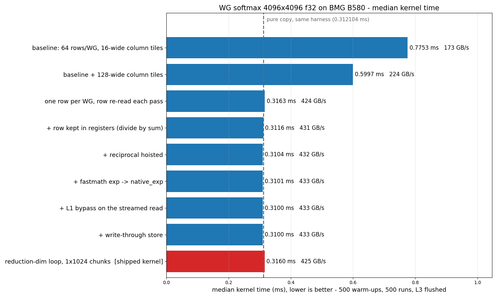

# Softmax Performance study on BMG B580

**Workload:** row-wise softmax over a `4096x4096` f32 matrix
(`test/Integration/Dialect/XeGPU/WG/softmax_4096x4096.mlir`).

### Machine-specific information:
-----------------------------
**Machine:** `BMG B580`, `160` compute units, `18 MiB` L3 cache, `456 GB/s` DRAM spec peak.

### Workload-specific information:
-----------------------------
**Input:** random numbers in `[-0.5, 0.5]`

**Shape:** `4096 x 4096` f32 (64 MiB in, 64 MiB out)

**Decomposition:** one row per work-group, walked in `1x1024` chunks (4 iterations)

**Work-group size:** `512` work-items (32 subgroups). **Grid:** `4096` work-groups.

### Measurement:
-----------------------------
- `IMEX_ENABLE_PROFILING=1`, `IMEX_PROFILING_WARMUPS=500`, `IMEX_PROFILING_RUNS=500`,
  `IMEX_ENABLE_CACHE_FLUSHING=1`, default GRF.
- The cache flush fills a buffer four times the L3 size with zeros and waits for it before each
  timed run (the updated `build_tools/patches/0013`). Flushed times are lower than
  back-to-back times here: the data is much larger than the L3, so there is no warm cache
  to lose, and a back-to-back run starts with the previous run's output still dirty in
  the cache. Earlier versions of this report used an older flush, so their times are higher.
- Each time is the median of 11 interleaved repetitions. All rows come from one batch,
  so they can be compared directly.
- **Effective GB/s** is `134217728 Byte` (one read and one write of the matrix) divided
  by the time.

## Summary (optimization ladder)

Each row changes one thing from the row above. The last row is a pure copy of the same
data in the same harness, for reference.

| Configuration | Median (ms) | Effective GB/s | Speedup vs. baseline |
| --- | ---: | ---: | ---: |
| Baseline: 64 rows/WG, 16-wide column tiles | 0.775320 | 173.1 | 1.00x |
| Baseline + 128-wide column tiles | 0.599664 | 223.8 | 1.29x |
| One row per WG, row re-read on every pass | 0.316264 | 424.4 | 2.45x |
| + row kept in registers | 0.311584 | 430.8 | 2.49x |
| + reciprocal hoisted out of the row | 0.310440 | 432.3 | 2.50x |
| + `fastmath` on the `exp` | 0.310128 | 432.8 | 2.50x |
| + L1 bypass on the streamed read | 0.310024 | 432.9 | 2.50x |
| + write-through store | 0.310024 | 432.9 | 2.50x |
| **Row 5 + reduction-dim loop, `1x1024` chunks (shipped)** | **0.315952** | **424.8** | **2.45x** |
| *Reference: pure copy of the same data* | 0.312104 | 430.0 | 2.48x |

## Median time comparison



## Optimization details

- **Baseline** — 64 rows per work-group in 16-wide column tiles (`sg_data = [8, 16]`):
  an online max/sum loop, then a second loop that re-reads the tile and normalizes.
- **128-wide column tiles** — the same decomposition with a wider tile
  (`sg_data = [8, 128]`): `1.29x`.
- **One row per work-group** — the change that matters:
  `2.45x`. Each work-group loads one
  row as a `1x4096` tile (`sg_layout = [1, 32]`, `sg_data = [1, 128]`), and the grid grows
  from 64 to 4096 work-groups.
- **Row in registers, reciprocal hoist, `fastmath`, L1 bypass, write-through** — each
  moves the time by `1.48%` or less. Only the reciprocal hoist is kept: it replaces
  4096 divides with one divide and 4096 multiplies.
- **Shipped** — the whole-row kernel, walked in `1x1024` chunks. Each pass keeps a
  chunk-sized element-wise accumulator and reduces it once, after its loop. It is
  `1.78%` slower than row 5, the whole-row form,
  and its live vector size does not grow with the row length.

## Design choices

Each alternative is measured against the shipped kernel in the same batch.

| Choice | Shipped | Alternative tested | Alternative vs. shipped |
| --- | --- | --- | ---: |
| Chunk size | `1024` | `2048` | -0.07% |
| Work-group size | `512` | `256` | -0.49% |
| Register file | default | large | +11.03% |
| Max and sum | separate passes | one fused online pass | +0.63% |
| Row layout | one row over 32 subgroups (`[1, 32]`) | one row per subgroup, 32 rows per WG (`[32, 1]`), online form | +52.91% |

The loop matters more for a longer row. At `256 x 65536` with 512 work-items, the loop
takes `0.366 ms` and the whole row `0.428 ms`, so the loop is
`14.4%` faster. The whole row can win back with 1024
work-items (`0.327 ms`), but 1024 work-items cannot launch with the large
register file.

## Comparison with Triton

Existing Triton kernels for this operation, on the same input. The IMEX row is from the
same session as the Triton runs:

- **Intel tuned softmax** — `benchmarks/triton_kernels_benchmark/fused_softmax.py` from Intel's Triton repository: one row
  per program, autotuned over `num_warps` and the warp size.
- **Inductor** — `torch.compile(..., mode="max-autotune")`, the path Intel's Triton repository benchmarks.
  Inductor emits one fused Triton kernel.
- **Liger-Kernel** — version `0.8.4`, a hand-written Triton kernel library with XPU settings of its own.

| Kernel | No flush (ms) | Cache flushed (ms) |
| --- | ---: | ---: |
| **IMEX, this test** | **0.335192** | **0.315952** |
| Triton, Intel tuned softmax | 0.336041 | 0.313125 |
| Triton, Inductor | 0.335625 | 0.315625 |
| Triton, Liger-Kernel | 0.340312 | 0.315208 |
| *PyTorch eager `torch.softmax`* | 0.338541 | 0.315937 |

- **The kernels are within `1.5%` of each other.**
  Without a flush, the IMEX kernel is the fastest, by `0.1%` or more.
  With the cache flushed, Intel tuned softmax is the fastest, `0.9%` ahead of IMEX.
  Which kernel is fastest changes with the cache state, so neither side is clearly ahead.
- "Same input" means the same values written the same way. The input is built on the
  host with this test's generator and copied to the device, as the test does. That
  matters on this GPU: the same layer norm values stream 17% faster when a host-to-device
  copy wrote them than when GPU kernels did.
- "Cache flushed" is the same flush on both sides: write zeros over a buffer four times
  the L3 size, and wait for it before the timed launch (torch's usual `zero_()`).
- Triton times are the torch XPU profiler's device time: median of 500 runs after 500
  warm-ups, median of 3 processes. The Triton kernels match the f64 reference to `1.1e-10`.

## Known limits

- A cross-subgroup `vector.multi_reduction` inside the `scf.for` gives wrong results.
  Softmax hides it, because normalization cancels the error; the layer norm test shows
  it. Every reduction in this kernel is after its loop.
- A loop that runs only once (chunk = `4096`) fails `xegpu-propagate-layout`.
- Only shapes that divide evenly into the chunk are tested.

## Key observations

- **One change gives the whole speedup:** one row per work-group. Every other change
  moves the time by `1.48%` or less.
- **The kernel runs close to copy speed.** It is
  `1.2%` slower than a pure copy of the same data in the same harness.
- **On par with Triton.** On the same input it is within `0.9%` of the fastest
  existing Triton kernel. Which one is ahead depends on the cache state.
- **Default GRF is the right choice.** The large register file is
  `11.0%` slower.
- **Bandwidth depends on the input values,** because the GPU compresses memory. Do not
  compare GB/s across tests that use different inputs.

## How to reproduce

```bash
# Correctness
llvm-lit -v test/Integration/Dialect/XeGPU/WG/softmax_4096x4096.mlir

# Timing, with the settings above
export IMEX_ENABLE_PROFILING=1
export IMEX_PROFILING_WARMUPS=500
export IMEX_PROFILING_RUNS=500
export IMEX_ENABLE_CACHE_FLUSHING=1
imex-opt test/Integration/Dialect/XeGPU/WG/softmax_4096x4096.mlir \
    --gpu-lower-to-xevm-pipeline="xegpu-op-level=workgroup" \
  | mlir-runner --shared-libs=$MLIR_LEVELZERO_RUNTIME \
                --shared-libs=$MLIR_RUNNER_UTILS \
                --shared-libs=$MLIR_C_RUNNER_UTILS \
                --shared-libs=$IMEX_RUNNER_UTILS \
                --entry-point-result=void
```
